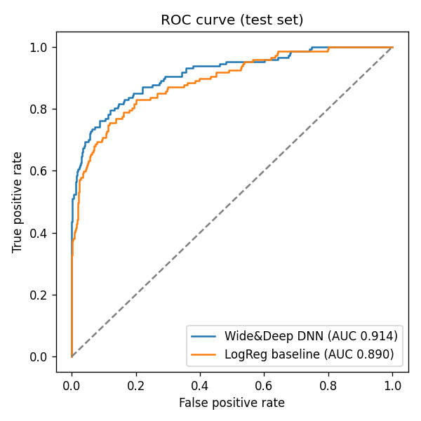
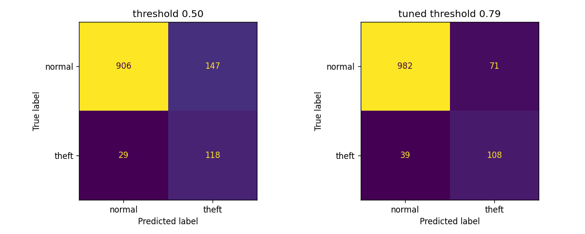

# ⚡ Electricity Theft Detection with a Wide & Deep Neural Network

Detects electricity theft from smart-meter daily consumption data using a TensorFlow
**Wide & Deep CNN**, then ranks customers so field teams know whom to inspect first.



| Model (held-out test set, 1,200 customers) | Threshold | Accuracy | AUC | Precision | Recall | False positives |
|---|---|---|---|---|---|---|
| Logistic regression baseline | 0.50 | 83.5% | 0.890 | 40.9% | 77.6% | 165 |
| Wide & Deep DNN | 0.50 | 85.3% | 0.914 | 44.5% | 80.3% | 147 |
| **Wide & Deep DNN (tuned threshold)** | **0.79** | **90.8%** | **0.914** | **60.3%** | **73.5%** | **71 (−57% vs baseline)** |

*Results from the included synthetic dataset (6,000 customers × 364 days, 12.3% thieves),
taken from [`reports/metrics.json`](reports/metrics.json). Best hyperparameters: 64 units,
dropout 0.2, learning rate 1e-3. Tuning the threshold cut false positives by 51.7% vs. the
default 0.5 threshold, at the cost of some recall (80.3% → 73.5%).*

### Plots and screenshots

| What | File |
|---|---|
| ROC curve (baseline vs. DNN) | [`reports/roc_curve.png`](reports/roc_curve.png) |
| Confusion matrices | [`reports/confusion_matrices.png`](reports/confusion_matrices.png) |
| Training curves (loss / AUC per epoch) | [`reports/training_curves.png`](reports/training_curves.png) |

<!-- TODO: add Streamlit dashboard screenshots.
     1. Run `streamlit run app.py`, open http://localhost:8501, click "use 300 sample customers".
     2. Capture (Win+Shift+S): (a) the ranked inspection list, (b) one flagged customer's chart.
     3. Save them as reports/dashboard_list.png and reports/dashboard_customer.png, then add:
        
        
     Note: reports/*.png are regenerated by train.py; dashboard_*.png are not, so they are safe there. -->



---

## What the project does

1. **Loads** daily kWh readings for thousands of customers (one row per customer).
2. **Cleans** the data: fills missing readings, caps sensor spikes, scales each customer to 0–1.
3. **Engineers features** that thieves give away: sudden drops, flat-lined readings, many zero days, broken weekly rhythm.
4. **Trains a 3-branch neural network**:
   - *Wide* branch: Dense layers over the whole daily series (global pattern)
   - *Deep* branch: Conv2D over a **weeks × 7-days "image"** (honest homes have a weekly rhythm, theft breaks it)
   - *Stats* branch: the engineered features
5. **Tunes hyperparameters** (units, dropout) on a validation set.
6. **Tunes the decision threshold** to cut false positives while keeping ≥95% of the recall, because every false positive is a wasted site visit.
7. **Serves** an interactive Streamlit dashboard: upload data → ranked inspection list → inspect any customer's chart.

```
CSV ──► clean ──► features ──► ┌ Wide (Dense)  ┐
                               ├ Deep (Conv2D) ├─► concat ─► Dense ─► P(theft) ─► threshold ─► inspection list
                               └ Stats (Dense) ┘
```

## Project structure

```
electricity-theft-detection/
├── app.py                 # Streamlit dashboard
├── src/
│   ├── generate_data.py   # synthetic SGCC-format dataset (6 theft attack types)
│   ├── preprocess.py      # cleaning, scaling, feature engineering, reshaping
│   ├── model.py           # Wide & Deep CNN in Keras
│   └── train.py           # baseline, hyperparameter search, threshold tuning, plots
├── data/                  # datasets (large CSVs are git-ignored)
├── models/                # saved model + threshold
└── reports/               # metrics.json + plots
```

---

## Step-by-step: run it yourself

### Step 1 — Install Python and create a virtual environment
Install Python 3.10–3.12 from python.org (tick "Add to PATH" on Windows). Then in a terminal:

```bash
cd electricity-theft-detection
python -m venv .venv
# Windows:            .venv\Scripts\activate
# macOS / Linux:      source .venv/bin/activate
pip install -r requirements.txt
```
A virtual environment keeps this project's packages separate from other projects.

### Step 2 — Generate the dataset
```bash
python src/generate_data.py
```
Creates `data/synthetic_sgcc.csv`: 6,000 customers × 364 days, ~12% thieves, with missing
values, sensor spikes, vacations and honest behaviour changes, so the task is not trivially easy.

**Learn:** open `generate_data.py` and read `apply_theft()`. The six attacks (constant
under-reporting, cut-off, random scaling, mean replacement, zero days, random mean) come
from the research literature on false data injection.

### Step 3 — Understand the preprocessing
Read `src/preprocess.py` top to bottom. Interview-ready explanation:
- **Interpolation** fills gaps without inventing big jumps.
- **Outlier capping** (mean + 2σ per customer) stops a single glitch from squashing everything else to zero after scaling.
- **Per-customer min-max scaling** makes the model learn the *shape* of usage, not house size.
- **Weekly reshape** turns 364 days into a 52×7 grid so a CNN can see weekly periodicity.

### Step 4 — Train the model
```bash
python src/train.py
```
Takes ~2–4 minutes on a laptop CPU. You will see:
1. the baseline's results,
2. the hyperparameter search (validation AUC for each combination),
3. epoch-by-epoch training,
4. the chosen threshold, and
5. the final test-set comparison and false-positive reduction.

Outputs: `models/theft_model.keras`, `models/config.json`, `reports/metrics.json`, and three plots.

**Learn:** in `train.py`, look at
- `compute_class_weight` → thieves are rare, so their errors are weighted more;
- `EarlyStopping` → stops when validation AUC stops improving (prevents overfitting);
- `best_threshold()` → the business logic behind "reduced false positives".

### Step 5 — Launch the dashboard
```bash
streamlit run app.py
```
Open http://localhost:8501 → click **"use 300 sample customers"** (or upload
`data/sample_customers.csv`). Move the threshold slider and watch the flagged count change.
Pick a high-probability customer and look at the chart: you'll usually see a sudden drop or zero days.

### Step 6 — Experiment (this is what makes it *your* project)
- Try more hyperparameters: `python src/train.py --units 64 128 256 --dropout 0.2 0.3 0.5 --lr 1e-3 5e-4`
- Add a feature in `engineer_features()` (e.g., weekend/weekday ratio) and see if AUC improves.
- Add an LSTM branch in `model.py` and compare.

### Step 7 — Use the real SGCC dataset (recommended for your portfolio)
1. Search Kaggle for **"SGCC electricity theft detection"** and download `data.csv`
   (42,372 customers, 1,035 days, ~8.5% thieves).
2. Put it in `data/data.csv`.
3. Run `python src/train.py --data data/data.csv` (slower: use Google Colab with a GPU if your laptop struggles. Upload the folder, `pip install -r requirements.txt`, and run the same command).
4. Update the results table at the top of this README with **your** numbers from `reports/metrics.json`.

> The dashboard expects the same number of days the model was trained on. After training on
> real data, upload a slice of the real CSV.

### Step 8 — Put it on GitHub
See the main guide (`PORTFOLIO_GUIDE.md`). Commit `reports/*.png` so the README shows the plots.

---

## How to explain it in an interview (30 seconds)
"I built a Wide & Deep CNN in TensorFlow to detect electricity theft from smart-meter data.
The wide branch looks at the whole consumption series, the deep branch treats each customer's
data as a weeks-by-days image so convolutions pick up weekly periodicity that theft breaks,
and a third branch uses engineered features like zero-day ratio and consumption drop. I handled
class imbalance with class weights, tuned hyperparameters on a validation set, and tuned the
decision threshold to minimise false positives while keeping recall, because each false alarm
costs a field visit. I served it in a Streamlit dashboard that ranks customers for inspection."

**Likely questions:** Why AUC and not just accuracy? (With 90% honest customers, predicting
"honest" for everyone gives 90% accuracy; AUC measures ranking quality.) Why a threshold other
than 0.5? (Business cost of false positives vs. missed thieves.) How would you deploy it?
(Batch scoring nightly, FastAPI endpoint, monitor drift as tariffs/seasons change.)

## References
- Zheng et al., *Wide and Deep Convolutional Neural Networks for Electricity-Theft Detection to Secure Smart Grids*, IEEE TII, 2018.
- Jokar et al., *Electricity Theft Detection in AMI Using Customers' Consumption Patterns*, IEEE TSG, 2016.
